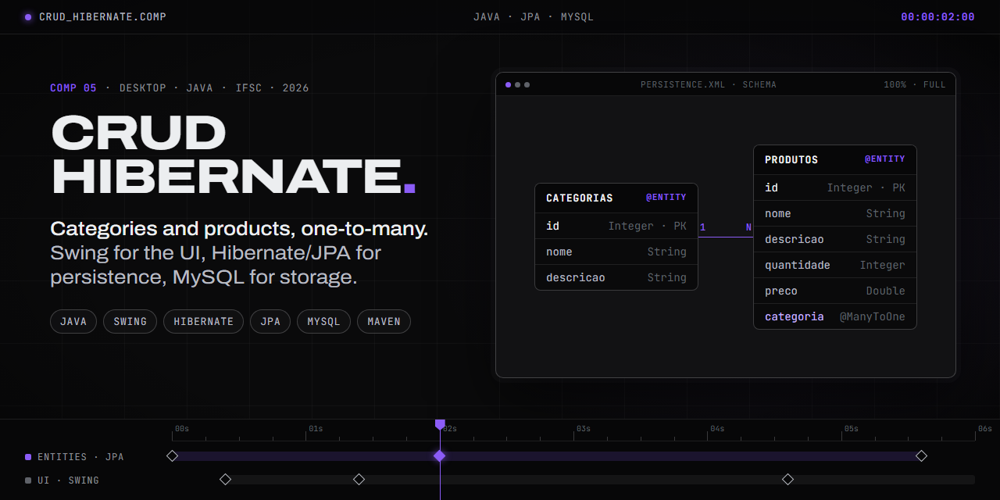

<div align="center">

**English** · [Português (Brasil)](README.pt-BR.md)

</div>



# Two-Table CRUD — Swing + Hibernate (MySQL)

**Authors:** Kaio Felipe Homem and Jefferson Machado
**Course:** Object-Oriented Systems Development — CC3 — 2026/1 (IFSC)
**Professor:** Edinilson da Silva Vida

A Java desktop application that manages **Categories** and their related **Products** (one-to-many).
Selecting a category filters the products table to the items linked to it.
A `JComboBox` lets you pick the category when saving or editing a product.

<sub>Class names, UI labels and the database schema are in Portuguese (`Categoria`, `Produto`).</sub>

## Structure

```
CrudHibernate/
├── pom.xml
├── script_banco.sql
└── src/main/
    ├── java/br/edu/ifsc/crudhibernate/
    │   ├── Main.java
    │   ├── model/   → Categoria.java, Produto.java
    │   ├── dao/     → CategoriaDAO.java, ProdutoDAO.java
    │   ├── util/    → JPAUtil.java
    │   └── view/    → FrmCategoriaProduto.java
    └── resources/META-INF/persistence.xml
```

## Running it

1. Have **MySQL** running. Set the user and password in `src/main/resources/META-INF/persistence.xml`
   (default: user `root`, password `root`). The `crudhibernate` database is created automatically.
2. From the command line, inside the `CrudHibernate/` folder:
   ```
   mvn clean compile
   mvn exec:java
   ```
3. Or open it as a Maven project in **NetBeans** and run the `Main` class.

> Hibernate runs with `hbm2ddl.auto=update`, so it creates the tables by itself.
> If you prefer to create the database by hand, run `script_banco.sql` and switch it to `none`.

## Features

- Full CRUD for Categories and Products (save, edit, delete, list).
- `@ManyToOne` relationship (Product → Category) through Hibernate/JPA.
- Products filtered by category (table and combo box).
- Validation: a product cannot be saved without a category.
- Separate clear methods for each form.
